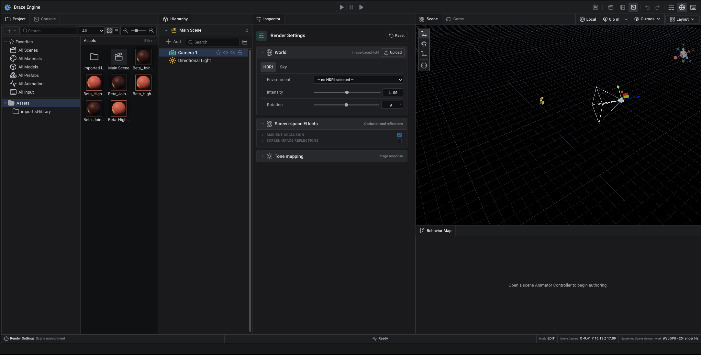

# Braze Engine

Braze is an experimental WebGPU game engine and browser-based editor for
agent-led game development and manual authoring. It uses TypeScript, React and
Three.js, with public JavaScript APIs and discoverable automation tools.

[](docs/images/braze-editor.png)

**Early development:** APIs and document formats may change. Many production
features are unfinished. The [capability ledger](docs/STATUS.md) distinguishes
implemented features, tested behavior and planned work.

## What is included

- Scene hierarchy, component Inspectors, docking, undo/redo and revisioned saves.
- Asset import with stable identities, materials, prefabs and animation authoring.
- WebGPU rendering and rigid-body physics, with explicit platform requirements.
- JavaScript behaviors, input maps, character controls, cameras and responsive UI.
- Local HTTP/CLI/MCP tools for authoring, inspection, playtests and static export.
- A small project template and isolated test fixtures for engine development.

This repository contains the reusable engine. Games, proprietary content and
project backups belong in separate directories or repositories. Runtime audio,
game saves, scene transitions, navigation and other features remain unfinished.

## Run the editor

Use Node.js 22.12 or newer, npm, Git, and a browser/device with WebGPU support.
The persistent launcher requires a Unix shell, `ps` and `lsof`. Development is
verified on macOS; other operating systems and GPU combinations need validation.
There is no WebGL fallback. No API key or paid service is required.

```sh
git clone https://github.com/snack-gamer/braze-engine.git
cd braze-engine
npm ci
./start.sh
./start.sh --status
```

Open http://127.0.0.1:5179. A fresh launch uses an empty local workspace under
`.braze/workspace/`, excluded from Git. Use `./stop.sh` to stop this checkout's
server. The editor server is a trusted local development tool, not an
authenticated public hosting service.

## Create a project

From the engine repository root:

```sh
npm run create:game -- ../my-game "My Game"
BRAZE_PROJECT_ROOT="$(cd ../my-game && pwd)" ./start.sh --restart
```

The destination must not already exist. Save any open project before switching.
The starter demonstrates movement, jumping, collection and a small UI. Its code
lives in the new project's `assets/Scripts/` directory and imports `@braze/game`.
Keep that project in its own repository. For scripting and exporting a static
player, see [Gameplay and JavaScript](docs/GAMEPLAY_RUNTIME.md) and
[Operations](docs/OPERATIONS.md#player-build).

## Work with an agent

Use the [Braze game developer skill](skills/braze-game-developer/SKILL.md).
Agents discover actual capabilities before editing and share the editor's
authoring operations. To inspect the local API or print an MCP configuration:

```sh
node scripts/engine-agent.mjs capabilities
npm run mcp:config
```

See the [MCP setup](docs/OPERATIONS.md#mcp-connection) and
[agent development contract](docs/AI_GAME_DEVELOPER.md).

## Documentation

| Guide | Covers |
| --- | --- |
| [AI game development contract](docs/AI_GAME_DEVELOPER.md) | Agent tools and acceptance requirements. |
| [Coding rulebook](docs/CODING_RULEBOOK.md) | Architecture, component authoring and GPU residency. |
| [Engine architecture](docs/ENGINE_ARCHITECTURE.md) | Editor, persistence, assets and rendering. |
| [Gameplay and JavaScript](docs/GAMEPLAY_RUNTIME.md) | Projects, behaviors, input, entities, prefabs and UI. |
| [Character system](docs/CHARACTER_SYSTEM.md) | Rigs, Avatars, Animator, retargeting and root motion. |
| [Physics](docs/PHYSICS_ENGINE.md) | Supported simulation, queries and limitations. |
| [Operations](docs/OPERATIONS.md) | Servers, checks, browser tests and export. |
| [Status and next work](docs/STATUS.md) | Current capabilities and acceptance evidence. |

## Contribute

Read [CONTRIBUTING.md](CONTRIBUTING.md) and [AGENTS.md](AGENTS.md) before changing
the engine. Small fixes, reproducible bug reports and improvements to the
documented workflows are welcome. Discuss substantial features before starting.
See [SECURITY.md](SECURITY.md) for reporting vulnerabilities.

## License

Braze's original code, templates and artwork are available under the
[MIT License](LICENSE). Third-party dependencies and fonts retain their own
licenses. See [THIRD_PARTY_NOTICES.md](THIRD_PARTY_NOTICES.md).
